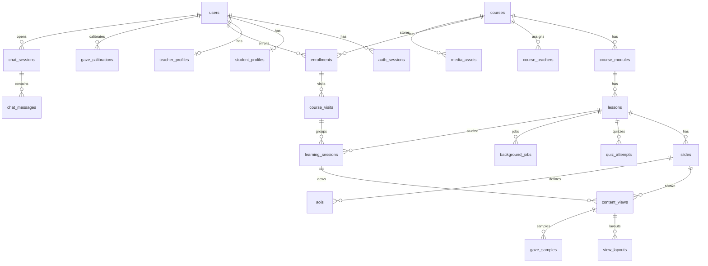

# DB.md — Từ điển cơ sở dữ liệu GazeEdu / EyeLearning

> **Schema generation 13 · 24 bảng lõi · không versioning nội dung.**
>
> Không tính vào 24 bảng: `schema_migrations` (migration runner).
> `gaze_samples` là bảng thường, không còn partition tháng.
> Generation 13 thay `oauth_accounts` bằng `email_otps`, bỏ
> `gaze_samples.aoi_codes` và `slides.aoi_suggestions`.

## 1. Quy ước

- Tên bảng/cột `snake_case`; tên API vẫn camelCase.
- PK UUID `gen_random_uuid()`, riêng `gaze_samples.id` dùng `BIGSERIAL`.
- Thời gian `TIMESTAMPTZ`, UTC.
- FK cascade là cơ chế xóa dữ liệu liên quan chính.
- JSONB chỉ dùng cho dữ liệu lồng nhau có kiểm soát/gợi ý/derived.
- Mỗi user có một role trong `users.role`.

## 2. Tổng quan 24 bảng

| # | Nhóm | Bảng | Vai trò |
|---:|---|---|---|
| 1 | Danh tính | `users` | Tài khoản + hồ sơ cơ bản + role |
| 2 | | `auth_sessions` | Refresh session |
| 3 | | `email_otps` | Mã OTP đăng nhập sinh viên (hash, hạn dùng) |
| 4 | | `student_profiles` | Mã sinh viên, chương trình |
| 5 | | `teacher_profiles` | Mã giảng viên, khoa |
| 6 | Khóa học | `courses` | Khóa học hiện hành + trạng thái publish |
| 7 | | `course_teachers` | Giáo viên được gán xem khóa |
| 8 | | `enrollments` | Ghi danh |
| 9 | | `course_visits` | Một lần sinh viên vào khóa (ca học) |
| 10 | | `media_assets` | File PDF và file nguồn |
| 11 | Nội dung | `course_modules` | Chương |
| 12 | | `lessons` | Bài giảng/bài tập + quiz config |
| 13 | | `slides` | Trang PDF + index RAG |
| 14 | Job | `background_jobs` | Queue import/index/analyze |
| 15 | Quiz | `quiz_attempts` | Lượt làm + snapshot đề |
| 16 | Gaze | `gaze_calibrations` | Model calibration |
| 17 | | `learning_sessions` | Phiên học một bài, thuộc một ca |
| 18 | | `content_views` | Một lượt xem slide/quiz + metrics |
| 19 | | `view_layouts` | Layout DOM + rect JSONB + visible rect |
| 20 | | `gaze_samples` | Gaze thô + toạ độ gốc/slide + nhãn AOI |
| 21 | | `aois` | Vùng phân tích slide/UI |
| 22 | Chat | `chat_sessions` | Hội thoại |
| 23 | | `chat_messages` | Tin nhắn + citation |
| 24 | Metadata | `app_metadata` | generation + instance id |

## 3. ERD



## 4. Chi tiết bảng

### 4.1. `users`

Tài khoản gốc và hồ sơ cơ bản.

| Cột | Ý nghĩa |
|---|---|
| `id` | UUID PK |
| `email` | Email đăng nhập, unique lower |
| `password_hash` | Nullable nếu đăng nhập bằng OTP |
| `role` | `admin/teacher/student` |
| `status` | `active/suspended/banned` |
| `full_name`, `date_of_birth`, `gender`, `phone`, `avatar_url` | Hồ sơ |
| `email_verified_at` | Lần xác nhận OTP gần nhất |
| `last_login_at`, `created_at`, `updated_at`, `deleted_at` | Audit mềm |

Không còn `user_profiles`, `roles`, `user_roles`.

### 4.2. `auth_sessions`

Mỗi lần đăng nhập/refresh session. Chỉ lưu hash refresh token.
`expires_at`, `revoked_at`, `user_agent`, `ip_address`.

### 4.3. `email_otps`

Mã OTP đăng nhập sinh viên NEU. Không lưu mã gốc; chỉ lưu
`HMAC-SHA256(email:code)`.

| Cột | Ý nghĩa |
|---|---|
| `id` | UUID PK, đồng thời là `challengeId` trả về frontend |
| `email` | Email lower-case đã qua kiểm tra domain/định dạng |
| `code_hash` | Hash HMAC của mã OTP |
| `expires_at` | Hạn dùng (mặc định 15 phút) |
| `attempts`, `max_attempts` | Số lần nhập sai / trần (mặc định 5) |
| `consumed_at` | Đã dùng thành công |
| `invalidated_at` | Bị vô hiệu do gửi mã mới hoặc gửi mail lỗi |
| `requested_ip` | IP yêu cầu, phục vụ audit/rate limit |
| `created_at` | Thời điểm tạo |

Partial unique index bảo đảm mỗi email chỉ có tối đa một OTP đang active
(`consumed_at IS NULL AND invalidated_at IS NULL`). Maintenance xoá row hết hạn
quá 1 ngày. Email hợp lệ mặc định: `^\d{8}@st\.neu\.edu\.vn$`.

### 4.4. `student_profiles` / `teacher_profiles`

1:1 với `users.user_id`. Chứa mã sinh viên/giảng viên và chương trình/khoa.
Cascade khi xóa user.

### 4.5. `courses`

| Cột | Ý nghĩa |
|---|---|
| `owner_id` | Giáo viên sở hữu |
| `created_by` | Người tạo |
| `title`, `description`, `thumbnail_url` | Nội dung cấp khóa |
| `status` | `draft/published/archived` |
| `published_at` | Lần publish gần nhất |
| `show_gaze_dot`, `require_calibration` | Cờ runtime |
| `created_at`, `updated_at` | Audit |

Sửa khóa published áp dụng ngay; không có bản draft/published song song.

### 4.6. `course_teachers`

PK `(course_id, teacher_id)`. Giáo viên được phân công xem, không sở hữu.

### 4.7. `enrollments`

Unique `(course_id, student_id)`. Trạng thái `active/completed/dropped`.
Là anchor của learning sessions và quiz attempts.

### 4.8. `media_assets`

File vật lý trong local/R2.
`storage_backend`, `object_key`, `sha256`, `mime_type`, `byte_size`, `state`,
`page_count`, `source_format`. Unique `(course_id,sha256)` để tái sử dụng file.

### 4.9. `course_modules`

Chương hiện hành: `course_id`, `title`, `position`.
Unique `(course_id, position)`.

### 4.10. `lessons`

| Cột | Ý nghĩa |
|---|---|
| `module_id` | Chương chứa bài |
| `title` | Tên bài |
| `kind` | `lesson` hoặc `quiz` |
| `position` | Thứ tự trong chương |
| `pdf_asset_id` | PDF của bài giảng |
| `quiz_config` | JSONB cấu hình quiz |
| `created_at`, `updated_at` | Audit |

`quiz_config` dạng:

```json
{
  "instructions": "Chọn đáp án đúng",
  "durationMinutes": 30,
  "dueAt": "2026-12-01T00:00:00+07:00",
  "allowRetry": true,
  "allowChatbot": false,
  "status": "published",
  "questions": [
    {
      "id": "q1",
      "prompt": "...",
      "options": [{"id": "a", "text": "..."}],
      "correctOptionIds": ["a"],
      "points": 1,
      "explanation": "..."
    }
  ]
}
```

Không còn `lessons` + `lesson_versions` + `course_items` + `quiz_specs`.

### 4.11. `slides`

| Cột | Ý nghĩa |
|---|---|
| `lesson_id` | Bài chứa slide |
| `position` | Thứ tự hiển thị |
| `page_number` | Trang thật trong PDF |
| `title` | Tên slide |
| `transcript` | Text VLM/RAG |
| `embedding` | `vector(1024)` |
| `content_tsv` | Generated FTS |
| `index_status` | `none/pending/ready/failed` |
| `index_error` | Lỗi index |
| `pipeline_version`, `model_version` | Phiên bản ingest |

Delete slide cascade `aois`, `content_views`, `view_layouts`, `gaze_samples`.

### 4.12. `background_jobs`

Queue nền chung.

| Cột | Ý nghĩa |
|---|---|
| `lesson_id` | Đối tượng job; cascade theo bài |
| `kind` | `import_slides/index_slides/analyze_lesson` |
| `status` | `queued/processing/ready/failed/cancelled` |
| `payload` | JSONB payload theo loại |
| `attempts`, `max_attempts`, `error` | Retry |
| timestamps | Claim/hoàn tất |

Worker claim bằng `FOR UPDATE SKIP LOCKED`.

### 4.13. `quiz_attempts`

`enrollment_id`, `lesson_id`, `attempt_no`, `status`, `expires_at`,
`submitted_at`, `quiz_snapshot`, `answers`, `grading`, `score`, `max_score`.

- Unique `(enrollment_id, lesson_id, attempt_no)`.
- Partial unique một attempt `in_progress` / enrollment / lesson.
- `quiz_snapshot` giữ đề tại thời điểm bắt đầu, nên sửa quiz không làm hỏng
  việc xem lại bài đã nộp.

### 4.14. `gaze_calibrations`

Gộp thiết bị + calibration:

`user_id`, `device_fingerprint`, `model_ubj`, `model_hash`, `model_version`,
viewport, DPR, screen origin, `num_points`, `created_at`.

Calibration hiện hành = row mới nhất theo `(user_id, device_fingerprint)`.
Không còn `devices.current_calibration_id`.

### 4.15. `course_visits`

Một lần sinh viên vào trang khóa học (“ca học” cấp khóa):

- `enrollment_id`
- `started_at`, `ended_at`, `last_seen_at`
- `status`: `active/ended/expired`
- `visit_key`: idempotency theo tab/navigation
- `created_at`, `updated_at`

Một ca có nhiều `learning_sessions` (mỗi lesson một session). Khi tab crash,
maintenance đánh dấu `expired` theo `last_seen_at`.

### 4.15.1. `learning_sessions`

Một phiên học bài, thuộc một ca:

`enrollment_id`, `lesson_id`, `course_visit_id`, `quiz_attempt_id`,
`calibration_id`, `pipeline_version`, viewport hiện tại + viewport calibration,
DPR, `tracking_consent`, `status`, timestamps.

Không còn `course_version_item_id`, `config JSONB`.

### 4.16. `content_views`

Một lượt hiển thị slide hoặc quiz, đồng thời giữ metrics.

| Nhóm cột | Cột |
|---|---|
| Định danh | `id`, `session_id`, `slide_id`, `surface`, `sequence_no` |
| Thời gian | `started_at`, `ended_at` |
| Metrics | `gaze_count`, `on_slide_gaze_count`, `tracked_duration_ms`, `fixation_count`, `heatmap_grid` |
| Thống kê AOI | `aoi_stats` JSONB: `{label: {ms, samples}}` cho dashboard Trực quan hoá |
| Phân tích | `analysis_status`, `analysis_version`, `analyzed_at` |

Công thức:

```text
attention = on_slide_gaze_count / gaze_count * 100
```

`aoi_stats` là dữ liệu dẫn xuất, được worker `gaze-metrics-v8` tính lại cùng
`gaze_samples.aoi_label`. Không thêm bảng; dashboard đọc một hàng mỗi lượt xem.

Mỗi lần vào slide/quiz tạo một `content_view` mới với UUID do client gửi
(`clientPresentationId`); quay lại slide cũ không ghi đè row cũ. Server cấp
`sequence_no = max + 1` trong session. `dwell_ms` được tính khi đọc:
`COALESCE(ended_at, session.ended_at, visit.ended_at, now()) - started_at`.
`CONTENT_VIEW_MIN_DWELL_MS` chỉ phân loại lượt xem đủ ngưỡng; tab Trực quan hoá
mặc định hiển thị tất cả lượt, kể cả lượt 0 sample hoặc thiếu layout.

### 4.17. `view_layouts`

Một snapshot vị trí tại thời điểm xem, luôn ở hệ toạ độ viewport hiện tại:

- `content_view_id`
- `layout_no`
- `slide_rect` JSONB: `{left, top, width, height}` của PDF trong viewport.
- `elements` JSONB: `[{code, key, xMin, yMin, xMax, yMax}, ...]`
- `captured_at`

Không còn `coordinate_space`, `visible_rect` hay bảng
`aoi_layout_snapshots` + `aoi_layout_rects`.

### 4.18. `gaze_samples`

Bảng quan trọng nhất cho phân tích.

| Cột | Ý nghĩa |
|---|---|
| `id` | BIGSERIAL PK |
| `content_view_id` | Lượt xem |
| `layout_id` | Layout đã dùng |
| `client_batch_id`, `sequence` | Idempotency |
| `event_time` | Thời điểm capture (WS header), không phải lúc nhận response |
| `viewport_x`, `viewport_y` | Gaze ở viewport hiện tại, normalized (canonical) |
| `slide_x`, `slide_y` | Gaze trên tọa độ slide (derived) |
| `aoi_label` | Nhãn duy nhất: `SLIDE_<label>`, `SLIDE_NO_LABEL`, tên UI AOI, hoặc `UI_NO_LABEL` |
| `status` | `ok/no_face/error/offscreen` |
| `quality_flags` | JSONB cờ chất lượng |

Unique `(content_view_id, client_batch_id, sequence)` chống trùng.
Không có `gaze_batches`, `aoi_hits`.

Export một sample không cần join bảng phân tích:

```sql
SELECT gs.event_time, gs.viewport_x, gs.viewport_y,
       gs.slide_x, gs.slide_y, gs.aoi_label,
       cv.slide_id, cv.session_id, ls.enrollment_id, ls.course_visit_id
FROM gaze_samples gs
JOIN content_views cv ON cv.id = gs.content_view_id
JOIN learning_sessions ls ON ls.id = cv.session_id
WHERE ls.lesson_id = $1;
```

### 4.19. `aois`

Một AOI gắn trực tiếp slide hoặc UI schema:

| Cột | Ý nghĩa |
|---|---|
| `slide_id` | Nullable; AOI slide |
| `ui_schema` | Nullable; AOI giao diện, vd `reader-v1` |
| `code`, `name` | Mã/tên hiển thị |
| `label` | Nhãn phân tích do giáo viên đặt cho leaf slide (`AOI_1`, `AOI_THANHCHAT`, …), regex `^AOI_[A-Z0-9_]{1,60}$`; NULL với container/no_label/UI |
| `parent_id` | Cây vùng |
| `geometry` | JSONB `{xMin,yMin,xMax,yMax}` hoặc selector/anchor |
| `is_container` | Vùng chứa |
| `kind` | `text/image/table/drawing/custom/ui/system` |
| `is_active` | Bật/tắt |

Check đúng một trong `slide_id`/`ui_schema`.
Unique `(slide_id,code)`, `(ui_schema,code)` và `(slide_id,label)`.
Không còn `aoi_sets`, revision, published state.

### 4.20. `chat_sessions`

`student_id`, `course_id`, `lesson_id`, `quiz_attempt_id`, `title`,
`context_key`, timestamps. Xóa bài sẽ xóa chat gắn bài.
Không còn course/lesson version columns.

### 4.21. `chat_messages`

`session_id`, `role`, `content`, `citations JSONB`, `intent`, `created_at`.
Backend là nguồn sự thật lịch sử chat.

### 4.22. `app_metadata`

Key-value: `schema_generation='13'`, `db_instance_id`.
Backend fail-fast nếu generation sai.

## 5. JSONB được giữ

| Bảng | Cột | Lý do |
|---|---|---|
| `lessons` | `quiz_config` | Snapshot đề + cấu hình runtime |
| `quiz_attempts` | `quiz_snapshot`, `answers`, `grading` | Snapshot lúc làm/chấm |
| `content_views` | `heatmap_grid` | Derived 24×24, row-major `grid[y][x]` |
| `view_layouts` | `slide_rect`, `elements` | Layout phụ trợ worker |
| `aois` | `geometry` | Rect slide hoặc selector UI |
| `gaze_samples` | `quality_flags` | Cờ pipeline linh hoạt |
| `chat_messages` | `citations` | Mảng citation |
| `background_jobs` | `payload` | Payload theo loại job |

## 6. Cascade xóa

| Hành động | Dữ liệu mất |
|---|---|
| Xóa `courses` | modules, lessons, slides, AOIs, enrollments, course visits, sessions, views, layouts, samples, attempts, chats, media, jobs |
| Xóa `course_modules` | lessons và toàn bộ dữ liệu trên |
| Xóa `lessons` | slides, attempts, learning sessions, views, gaze, chats, jobs |
| Xóa `slides` | AOIs, content views, layouts, gaze samples |
| Xóa `enrollments` | course visits, learning sessions/views/gaze và quiz attempts |
| Xóa `users` | profile, enrollments, sessions, calibration, chat |

Không còn trigger bất biến hay `app.allow_course_delete`.
File local/R2 được backend dọn theo prefix sau transaction.

## 7. Gaze → AOI → metrics

```text
viewport_x/y (viewport tại thời điểm ghi)
  → trừ slide_rect.left/top, chia width/height
  → slide_x/y

slide_x/y trong [0,1]
  → chọn MỘT leaf slide (custom > text > table > image > drawing > system,
    cùng hạng thì diện tích nhỏ hơn)
  → aoi_label = SLIDE_<aois.label>; không leaf → SLIDE_NO_LABEL
  → aois.label do giáo viên đặt, dạng AOI_THANHCHAT, AOI_BANGBIEU…
  → không cộng container, không trộn UI

ngoài slide / quiz / layout thiếu
  → chọn MỘT UI AOI (custom trước, rồi diện tích nhỏ hơn)
  → aoi_label = aois.name; không match → UI_NO_LABEL

toàn bộ samples của content_view
  → gaze_count, on_slide_gaze_count
  → tracked_duration_ms (gap <= max(250, 3000/FPS))
  → fixation_count
  → heatmap_grid 24×24 row-major (grid[y][x])
```

Thiếu layout/`slide_rect` rỗng: không identity map; `slide_x/y = NULL`,
`quality_flags.layout_missing = true`, nhãn UI (`UI_NO_LABEL` nếu không map
được element).

Sửa AOI/xóa AOI chỉ cần reanalyze; gaze thô không đổi.

### 7.1. Truy vấn ca học

```sql
-- Tất cả ca của mọi sinh viên trong một khóa
SELECT v.id AS visit_id, e.student_id, v.started_at, v.ended_at,
       count(ls.id) AS lesson_session_count
FROM course_visits v
JOIN enrollments e ON e.id = v.enrollment_id
LEFT JOIN learning_sessions ls ON ls.course_visit_id = v.id
WHERE e.course_id = $1
GROUP BY v.id, e.student_id, v.started_at, v.ended_at
ORDER BY e.student_id, v.started_at;

-- Gaze của một ca, lọc theo slide/AOI
SELECT gs.event_time, gs.viewport_x, gs.viewport_y,
       gs.slide_x, gs.slide_y, gs.aoi_label
FROM gaze_samples gs
JOIN content_views cv ON cv.id = gs.content_view_id
JOIN learning_sessions ls ON ls.id = cv.session_id
WHERE ls.course_visit_id = $1
  AND ($2::uuid IS NULL OR cv.slide_id = $2)
  AND ($3::text IS NULL OR gs.aoi_label = $3)
ORDER BY gs.event_time, gs.sequence;
```

## 8. Retention & vận hành

- Gaze retention mặc định **180 ngày**.
- `python -m app.maintenance` xóa auth session hết hạn, đánh dấu learning session
  quá hạn, đánh dấu `course_visits` idle quá 30 phút là `expired`,
  xóa gaze sample cũ theo `event_time`, xóa `email_otps` hết hạn quá 1 ngày.
- Không còn partition tháng; retention dùng xoá row theo `event_time`.

## 9. Role DB

| Role | Quyền |
|---|---|
| Owner | Toàn quyền; API/worker |
| `chatbot_reader` | SELECT 3 view outline + SELECT/UPDATE cột index trên `slides` |
| `admin_reader` | SELECT read-only; không đọc `auth_sessions`, `email_otps`; `users` không có `password_hash` |

## 10. Migration

- Baseline: `001_baseline.sql` (generation **12**, gộp toàn bộ schema).
- Nâng cấp generation **13**:
  - `002_email_otp.sql`: `email_otps`, `users.email_verified_at`, bỏ
    `oauth_accounts`, cập nhật `app_metadata.schema_generation='13'`.
  - `003_aoi_single_label.sql`: bỏ `gaze_samples.aoi_codes` và
    `slides.aoi_suggestions`.
  - `004_content_view_aoi_stats.sql`: thêm `content_views.aoi_stats` JSONB
    cho dashboard Trực quan hoá (dẫn xuất, có thể tính lại).
  - `005_current_viewport_only.sql`: chuyển layout cũ sang viewport hiện tại,
    bỏ `view_layouts.coordinate_space/visible_rect` và
    `gaze_samples.original_viewport_x/y`.
- DB generation cũ **không migrate tại chỗ** nếu chưa có lịch sử
  `schema_migrations`. Phải backup và reset có guard.
- Không sửa `001_baseline.sql` đã áp; mọi thay đổi mới thêm file `00x_...sql`.
- Sau reset:
  ```bash
  ./scripts/backup.sh
  ./scripts/reset_db.sh --apply --database eyetracking \
    --confirm-reset eyetracking --seed-dev
  ```
- Kiểm tra: `./scripts/test_migrations.sh`, `make test-backend`.
