# Kiến trúc pipeline và các lựa chọn mô hình

> **Nguồn:** báo cáo này được chuyển từ repo nghiên cứu `EyetrackingResearch`
> (commit `f8bf481`) sang `docs/`. Pipeline torch gốc và các công cụ thu/chấm
> (`tools/collect.py`, `tools/evaluate.py`, `benchmark/*.py`) **không** còn trong
> repo này; lệnh `python tools/...` bên dưới chỉ chạy trong repo nghiên cứu đó.
> Dữ liệu ảnh mặt và kết quả thô nằm ở `benchmarks/gaze/testdata/` (gitignored)
> và `benchmarks/gaze/research-results/`.

Tài liệu này mô tả **pipeline eye tracking** của project, **hợp đồng dữ liệu** giữa các
tầng, và **các lựa chọn mô hình** (bộ phát hiện khuôn mặt, kích thước UniGaze, precision,
thiết bị chạy) kèm số đo thực tế để chọn cấu hình.

- Số đo lấy từ `models/benchmark_report.md` và `models/accuracy_report.md`
  (GPU NVIDIA RTX 3060, Torch 2.15 + CUDA 13.2).
- Accuracy đo trên `benchmarks/gaze/testdata/20261124_175802_frontal`: **100 target / 800 frame, 1 phiên,
  tư thế frontal**, giao thức `within` (k-fold theo target). Đây là điều kiện lý tưởng,
  không đại diện cho mọi góc đầu / ánh sáng.

---

## 1. Sơ đồ tổng quan

```mermaid
flowchart LR
    A[Webcam] --> B[FreshFrameReader<br/>thread đọc frame mới nhất]
    B --> C[Chuyển BGR → RGB]
    C --> D{Bộ phát hiện<br/>khuôn mặt}
    D -->|MediaPipe FaceLandmarker<br/>478 landmarks, CPU| E[6 điểm iBUG<br/>mắt + cánh mũi]
    D -->|face_alignment FAN<br/>68 landmarks, CUDA| E
    E --> F[Crop + mở rộng bbox<br/>crop_scale = 2.0]
    F --> G[Chuẩn hóa đầu<br/>solvePnP → warpPerspective]
    G --> H{Tư thế đầu<br/>vượt 80°?}
    H -->|có| X[Bỏ frame]
    H -->|không| I[UniGaze<br/>ViT + gaze_fc]
    I --> J[De-normalize<br/>R⁻¹ · gaze]
    J --> K[Calibration<br/>hồi quy tuyến tính]
    K --> L[One Euro Filter]
    L --> M[Vẽ điểm nhìn<br/>Tk canvas]
```



Toàn bộ luồng nằm trong `models.Pipline.process(frame)`; `main.py` chỉ lo webcam, hiệu
chuẩn, làm mượt và hiển thị.

---

## 2. Các tầng và chi phí thời gian

Số đo cho cấu hình tham chiếu **MediaPipe + UniGaze-B16 + fp32, 640×480** (tổng 18.4 ms/frame):

| # | Tầng | Đầu vào → đầu ra | Code | Thời gian |
| --- | --- | --- | --- | --- |
| 1 | Capture | webcam → frame BGR mới nhất | `utils.FreshFrameReader` | ngoài pipeline |
| 2 | Convert | `H×W×3 uint8 BGR` → `H×W×3 uint8 RGB` | `Preprocessor.process_rgb` | 0.05 ms |
| 3 | Detect | RGB → `bbox (x1,y1,x2,y2)` + `6×2 landmarks` (px) | `FaceDetectorModel` / `FaceAlignmentModel` | 8.6 ms |
| 4 | Crop | bbox → ảnh mặt RGB đã mở rộng 2× | `utils.expand_bbox` | ~0 ms |
| 5 | Preprocess | ảnh mặt + 6 điểm → `tensor (1,3,224,224)` + `R (3,3)` | `Preprocessor.process` | 1.2 ms |
| 6 | Gaze | tensor → `(pitch, yaw)` trong hệ đầu chuẩn hóa | `GazeModel` | 8.4 ms |
| 7 | De-normalize | `(pitch, yaw)`, `R` → `(pitch, yaw)` hệ camera | `utils.denormalize_gaze` | 0.06 ms |
| 8 | Calibration | `(pitch, yaw)` → `(x, y)` màn hình (px) | `calibration.Calibration.predict` | ~0.1 ms |
| 9 | Filter | chuỗi `(x, y)` → `(x, y)` mượt | `preprocessing.OneEuroFilter2D` | ~0 ms |
| 10 | Display | `(x, y)` → chấm đỏ trên canvas | `main.py` | theo Tk |

**Nhận xét quan trọng:** chi phí gần như chia đôi giữa *detect* và *gaze*. Vì vậy:

- Tăng kích thước UniGaze chỉ làm chậm nửa sau (xem mục 4.2).
- Thay MediaPipe bằng FAN làm chậm gấp ~3 lần ở tầng detect (27.5 ms), trong khi accuracy
  không khác biệt có ý nghĩa (xem mục 4.1).
- MediaPipe trong project này **luôn chạy CPU** (`Delegate.CPU` hard-code trong
  `models.py`), nên `--device` chỉ ảnh hưởng UniGaze và FAN.

---

## 3. Chi tiết từng tầng

### 3.1 Capture — luôn lấy frame mới nhất

`FreshFrameReader` chạy một thread daemon đọc `cv2.VideoCapture` liên tục; `read()` chỉ trả
frame mới nhất. Mục đích: nếu pipeline chậm hơn camera, hệ thống **bỏ frame cũ** thay vì
xử lý hàng đợi và tạo độ trễ ngày càng tăng.

### 3.2 Phát hiện khuôn mặt — 2 lựa chọn, cùng hợp đồng dữ liệu

Cả hai bộ phát hiện đều trả về `(bbox, 6 landmarks)` theo pixel, với 6 điểm tương ứng
iBUG-68 dùng cho chuẩn hóa:

```
4 góc mắt (ngoài phải, trong phải, trong trái, ngoài trái) + 2 cánh mũi
```

| | MediaPipe FaceLandmarker | FAN (`face_alignment`) |
| --- | --- | --- |
| Weight | `weights/face_landmarker.task` (TFLite float16) | tải tự động trong package |
| Số điểm | 478 (468 mesh + 10 iris) | 68 |
| Chỉ số 6 điểm | `[33, 133, 362, 263, 75, 290]` | `[36, 39, 42, 45, 31, 35]` |
| Thiết bị | CPU (TFLite delegate) | CUDA hoặc CPU |
| Resize trước detect | không | `×0.5` (`resize_factor`) |
| Detect @640×480 | **8.2–8.6 ms** | **27.5–29.3 ms** |
| FPS toàn pipeline (B16, fp32) | **54.3** | 27.2 |
| L2 median (B16) | 29.3 px | 28.7 px |
| Paired ΔL2 | — | −1.08 px, CI chứa 0 → **tương đương** |

Chọn MediaPipe làm mặc định: nhanh gấp ~3 lần, accuracy tương đương, không cần CUDA cho
tầng detect.

### 3.3 Crop

`expand_bbox(bbox, scale=2.0)` mở rộng bbox quanh tâm gấp đôi rồi cắt theo biên ảnh. Mục
đích: giữ ngữ cảnh quanh mặt (tai, tóc, vai) — giống cách UniGaze gốc huấn luyện. Đây là
`Pipline(crop_scale=2.0)`, có thể chỉnh khi khởi tạo.

### 3.4 Chuẩn hóa đầu (preprocess)

Mục đích: đưa khuôn mặt về **camera chuẩn** để UniGaze không phụ thuộc khoảng cách, vị trí
và góc quay của đầu.

1. `cv2.solvePnP` với 6 điểm 2D và mô hình mặt 3D 6 điểm (mm) → `rvec`, `tvec`.
   - Camera giả lập: `f = 4 × width`, principal point ở tâm ảnh crop.
   - Mô hình 3D: `Preprocessor.face_model` (4 góc mắt + 2 cánh mũi).
2. Tính tâm mặt = trung bình tâm mắt và tâm mũi trong hệ camera.
3. Dựng ma trận `W = K_norm · S · R · K⁻¹`:
   - `focal_norm = 960`, `distance_norm = 600`, ROI `224 × 224`.
   - `R` là ma trận xoay đưa mặt về chính diện.
4. `cv2.warpPerspective` ảnh mặt và `perspectiveTransform` 6 landmark.
5. **Gate tư thế đầu:** nếu `‖(pitch, yaw)‖ > 80°` → trả `None`, bỏ frame (tránh dự đoán
   gaze vô nghĩa khi mặt gần như nghiêng hẳn).
6. Chuẩn hóa ảnh: resize 224, `ToTensor`, normalize ImageNet
   (`mean=[0.485,0.456,0.406]`, `std=[0.229,0.224,0.225]`) → `tensor (1,3,224,224)`.
7. Trả thêm `R` để bước sau de-normalize gaze về hệ camera thật.

### 3.5 Ước lượng gaze — UniGaze

- Kiến trúc: `MAE_Gaze` = ViT (MAE pretrained) + `nn.Linear(embed_dim, 2)`.
- `forward = vit.forward_features(x) → gaze_fc → pred_gaze` (2 giá trị: pitch, yaw).
- **Không cần calibrate vào màn hình**; calibration ở mục 3.7 chỉ là hồi quy nhẹ phía sau.
- `GazeModel` chọn kiến trúc theo **tên file weight**:
  `os.path.splitext(basename)[0]` phải trùng key trong `unigaze.loader.MODEL_INDEX`
  (`unigaze_b16_joint`, `unigaze_l16_joint`, `unigaze_h14_joint`, `unigaze_h14_cross_X`).
  Đổi tên file sẽ làm load thất bại (`KeyError: Unknown builder`).

Ba lựa chọn ở tầng này: **kích thước model** (4.2), **precision** fp32/fp16 (4.3),
**thiết bị** CUDA/CPU (4.4).

### 3.6 De-normalize gaze

Gaze dự đoán nằm trong hệ tọa độ đầu đã chuẩn hóa. `denormalize_gaze` chuyển
`(pitch, yaw) → vector 3D → R⁻¹ · vector → (pitch, yaw)` để trả về hệ camera thật. Thiếu
bước này, kết quả sẽ "dính" theo hướng đầu.

### 3.7 Calibration → tọa độ màn hình

- `MultiOutputRegressor(LinearRegression)` của scikit-learn.
- Thu 16 điểm (mặc định `create_points(..., 16)`), mỗi điểm: nhìn 1 s → lấy `(pitch, yaw)`
  → nhãn `(x/w, y/h)`.
- Fit `(pitch, yaw) → (x_norm, y_norm)`; dự đoán nhân lại với `w, h`.
- Có thể đổi số điểm: `create_points` hỗ trợ 9 / 16 / 25.
- Lưu/đọc model bằng `ubjson` + `pickle` tại `weights/calibrator.ubj`
  (chỉ dùng khi **không** truyền `--new_calibration`).
- Lưu ý hiện tại (xem README): kết quả `--new_calibration` **chưa được ghi ra file**, chỉ
  dùng trong phiên chạy.

### 3.8 Làm mượt — One Euro Filter

`OneEuroFilter2D(min_cutoff=0.5, beta=0.01)` lọc toạ độ màn hình:

- `min_cutoff` thấp → mượt hơn khi đứng yên.
- `beta` cao → bám chuyển động nhanh hơn, ít trễ hơn.

Lọc sau calibration (trên toạ độ pixel) nên mức mượt đồng nhất trên toàn màn hình.

### 3.9 Hiển thị

`main.py` vẽ chấm đỏ bán kính 10 px trên `tk.Canvas` full-screen; cửa sổ OpenCV hiển thị
camera để debug, nhấn `q` để thoát.

---

## 4. Các lựa chọn mô hình

### 4.1 Bộ phát hiện khuôn mặt

| Tiêu chí | MediaPipe FaceLandmarker | FAN (`face_alignment`) |
| --- | --- | --- |
| Tốc độ detect | **~8 ms** | ~28–39 ms |
| FPS tốt nhất (B16, fp16, 640×480) | **67.8** | 30.2 |
| Accuracy (B16) | 29.3 px | 28.7 px |
| Paired test | \|ΔL2\| < 2 px → tương đương | |
| Phụ thuộc CUDA | không (CPU TFLite) | có, nếu muốn nhanh |
| Điểm mạnh | nhanh, nhẹ, ổn định, có iris | landmark mắt chi tiết hơn |
| Điểm yếu | không tận dụng GPU | chậm, nặng |

**Kết luận:** mặc định MediaPipe. Chỉ chọn FAN nếu cần landmark mắt chi tiết cho hướng
nghiên cứu khác, hoặc khi MediaPipe fail trên điều kiện đặc biệt (chưa kiểm chứng).

### 4.2 Kích thước UniGaze

Cùng một kiến trúc `MAE_Gaze` (ViT + `gaze_fc`), chỉ khác backbone. Số đo tại 640×480,
MediaPipe, CUDA:

| Model | Backbone | Tham số | File | FPS fp32 | FPS fp16 | Gaze fp32 | Gaze fp16 | VRAM fp32 | VRAM fp16 | L2 median (MP) | L2 median (FAN) |
| --- | --- | --- | --- | --- | --- | --- | --- | --- | --- | --- | --- |
| `unigaze_b16_joint` | ViT-B/16 | 86.6 M | 0.32 GB | 54.3 | **67.8** | 8.4 ms | **4.5 ms** | 345 MB | 189 MB | 29.3 px | 28.7 px |
| `unigaze_l16_joint` | ViT-L/16 | 304.3 M | 1.13 GB | 27.9 | 49.0 | 26.4 ms | 10.4 ms | 1178 MB | 594 MB | 23.9 px | 26.1 px |
| `unigaze_h14_joint` | ViT-H/14 | 632.0 M | 2.35 GB | 13.0 | 26.6 | 67.5 ms | 28.2 ms | 2496 MB | 1245 MB | **20.4 px** | 23.3 px |
| `unigaze_h14_cross_X` | ViT-H/14 | 632.0 M | 2.35 GB | 13.0 | 26.6 | 67.6 ms | 28.3 ms | 2496 MB | 1245 MB | 26.8 px | 23.9 px |

Ghi chú:

- `h14_cross_X` dùng **cùng kiến trúc** ViT-H/14 (state dict khớp `strict=True`, cùng số
  tham số), khác bộ weight do tác giả huấn luyện. Trên dữ liệu hiện tại nó **không** tốt
  hơn `h14_joint` một cách nhất quán (tệ hơn rõ với MediaPipe, tương đương với FAN) →
  không phải lựa chọn "miễn phí".
- Tăng model **không** làm chậm tầng detect; FPS toàn pipeline bị chặn bởi
  `detect + gaze`.
- Paired test giữa các kích thước (cùng detector) cho thấy L16 và H14 **chính xác hơn B16**
  với CI không chứa 0; H14 vs L16 thì CI chứa 0 (chưa kết luận được).
- Jitter giảm nhẹ khi tăng model: 0.77° (B16) → 0.66° (L16) → 0.67° (H14) → 0.64°
  (cross-X) với MediaPipe.

### 4.3 Precision (chỉ áp cho UniGaze)

| | fp32 | fp16 |
| --- | --- | --- |
| Hỗ trợ | mọi thiết bị | chỉ CUDA |
| Tốc độ gaze (B16) | 8.4 ms | **4.5 ms** (−47%) |
| FPS toàn pipeline (MP + B16) | 54.3 | **67.8** (+25%) |
| VRAM (B16) | 345 MB | **189 MB** |
| Sai số | — | ΔL2 = **0.01 px**, CI [−0.09, 0.06] → không đổi |

- Cách làm: `.half()` weight + input, output `.float()` ngay trước de-normalize để phần
  sau giữ fp32 (`models.GazeModel`).
- MediaPipe vẫn TFLite float16 trên CPU, FAN vẫn fp32 → **không phải fp16 toàn pipeline**.
- `--precision fp16` với `--device cpu` sẽ báo lỗi (không có kernel half cho đa số phép toán).

### 4.4 Thiết bị

| Cấu hình | FPS (B16, fp32, 640×480) |
| --- | --- |
| MediaPipe + CUDA | 54.3 |
| MediaPipe + CPU | 12.8 |
| FAN + CUDA | 27.2 |
| FAN + CPU | 3.7 |

CPU vẫn chạy được nhưng không đạt realtime; FAN trên CPU gần như không dùng được cho video.

---

## 5. Chọn cấu hình theo mục tiêu

| Mục tiêu | Cấu hình | FPS | L2 (MP) |
| --- | --- | --- | --- |
| Realtime mượt nhất | MediaPipe + B16 + fp16 | **67.8** | 29.3 px |
| Cân bằng tốt nhất | MediaPipe + L16 + fp16 | 49.0 | 23.9 px |
| Ưu tiên chính xác, vẫn realtime | MediaPipe + H14 + fp16 | 26.6 | **20.4 px** |
| Chỉ có CPU | MediaPipe + B16 + fp32 | 12.8 | 29.3 px |
| Nghiên cứu landmark mắt | FAN + H14 + fp16 | 17.6 | 23.3 px |

Quy tắc thực dụng:

1. Luôn bật `--precision fp16` nếu có GPU (miễn phí về accuracy).
2. Mặc định `MediaPipe`; đổi sang FAN chỉ khi có lý do cụ thể.
3. Chọn kích thước UniGaze theo ngân sách thời gian: mỗi bậc tăng ~2.5× chi phí gaze,
   đổi lại ~2–6 px L2.
4. Không chọn `h14_cross_X` trừ khi muốn tái lập thí nghiệm của tác giả.

---

## 6. Tham số có thể tinh chỉnh

| Tham số | Mặc định | Vị trí | Ảnh hưởng |
| --- | --- | --- | --- |
| `crop_scale` | `2.0` | `Pipline.__init__` | vùng ngữ cảnh quanh mặt; nhỏ → thiếu context, lớn → mặt nhỏ trong ảnh |
| `focal_norm` | `960` | `Preprocessor` | tiêu cự camera chuẩn; đổi cùng lúc với `distance_norm` |
| `distance_norm` | `600` | `Preprocessor` | khoảng cách chuẩn (mm) |
| `roi_size` | `(224, 224)` | `Preprocessor` | kích thước ảnh vào UniGaze (phải khớp patch/position embedding) |
| `max_head_pose_deg` | `80` | `Preprocessor` | ngưỡng bỏ frame khi đầu nghiêng quá nhiều |
| `points` | `16` | `create_points` | số điểm hiệu chuẩn (9/16/25) |
| `min_cutoff` | `0.5` | `OneEuroFilter2D` | độ mượt khi đứng yên |
| `beta` | `0.01` | `OneEuroFilter2D` | độ bám khi chuyển động nhanh |
| `--precision` | `fp32` | `utils.get_args` | fp32/fp16 cho UniGaze |
| `--face_detector` | `mediapipe` | `utils.get_args` | `mediapipe` hoặc `face_alignment` |

Lưu ý: `--gaze_estimator` hiện chỉ là tham số khai báo, pipeline luôn dùng UniGaze; muốn đổi
kích thước thì đổi `--gaze_estimator_weight` (tên file quyết định kiến trúc).

---

## 7. Bản đồ code

| File / lớp | Vai trò |
| --- | --- |
| `main.py` | vòng lặp webcam, calibration, filter, hiển thị |
| `models.Pipline` | ghép detect → crop → preprocess → gaze → de-normalize |
| `models.FaceDetectorModel` | MediaPipe FaceLandmarker, map 478 → 6 điểm |
| `models.FaceAlignmentModel` | FAN, resize 0.5, map 68 → 6 điểm |
| `models.GazeModel` | build UniGaze theo tên file, `.half()` khi fp16 |
| `preprocessing.Preprocessor` | solvePnP, chuẩn hóa ảnh, gate tư thế đầu |
| `preprocessing.OneEuroFilter2D` | làm mượt toạ độ màn hình |
| `calibration.Calibration` | thu 16 điểm, hồi quy tuyến tính, load/save `.ubj` |
| `utils` | đọc frame, `expand_bbox`, `denormalize_gaze`, tham số CLI |
| `tools/collect.py` | thu dữ liệu ground truth (chấm đỏ full-screen) — repo nghiên cứu |
| `tools/evaluate.py` | chấm L2/L1, CI bootstrap, paired test, vẽ biểu đồ — repo nghiên cứu |
| `benchmark/benchmark.py` | đo FPS/latency/VRAM theo cấu hình — repo nghiên cứu |
| `benchmark/report.py` | sinh báo cáo Markdown + hình từ JSON — repo nghiên cứu |

---

## 8. Chạy và đo lại

```bash
# Ứng dụng thật (có GPU)
python main.py --new_calibration --precision fp16

# Đo FPS cho 4 kích thước UniGaze
python benchmark/benchmark.py --devices cuda --precisions fp32,fp16 \
  --gaze-weights weights/unigaze_b16_joint.safetensors,weights/unigaze_l16_joint.safetensors,weights/unigaze_h14_joint.safetensors,weights/unigaze_h14_cross_X.safetensors

# Đo accuracy cho 4 kích thước
python tools/evaluate.py --gaze-weights weights/unigaze_b16_joint.safetensors,weights/unigaze_l16_joint.safetensors,weights/unigaze_h14_joint.safetensors,weights/unigaze_h14_cross_X.safetensors
```

- Báo cáo FPS: `benchmark_report.md` (fp32/fp16) và
  `models/benchmark_report.md` (4 kích thước).
- Báo cáo accuracy: `accuracy_report.md` và `models/accuracy_report.md`.
- Cache accuracy tách theo `detector / device / precision / model` trong `benchmarks/gaze/testdata/.cache/`,
  tự vô hiệu khi code pipeline thay đổi.

---

## 9. Hạn chế đã biết

1. **Dữ liệu accuracy hẹp:** 1 phiên, 1 người, tư thế frontal, 1 độ phân giải màn hình.
   Chưa kết luận được cho góc đầu lớn, ánh sáng yếu, người đeo kính, khoảng cách xa.
2. **MediaPipe luôn CPU:** GPU chỉ tăng tốc UniGaze/FAN. Muốn nhanh hơn nữa phải chuyển
   delegate (GPU delegate của MediaPipe) — chưa làm.
3. **fp16 chỉ cho UniGaze:** FAN vẫn fp32; chưa có "fp16 toàn pipeline".
4. **Calibration không được lưu:** `--new_calibration` chỉ có hiệu lực trong phiên chạy.
5. **`calibrator.ubj` không có trong repo/Drive hiện tại:** chế độ không hiệu chuẩn mới
   chưa chạy được cho tới khi có file này.
6. **FPS đo trên ảnh tĩnh:** không tính độ trễ camera và Tk; FPS thực tế khi chạy app thấp
   hơn một chút.
