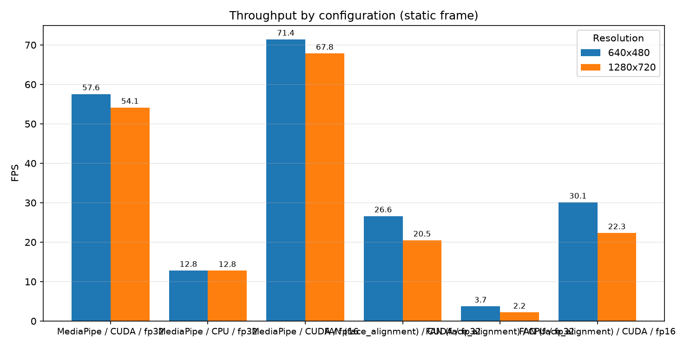
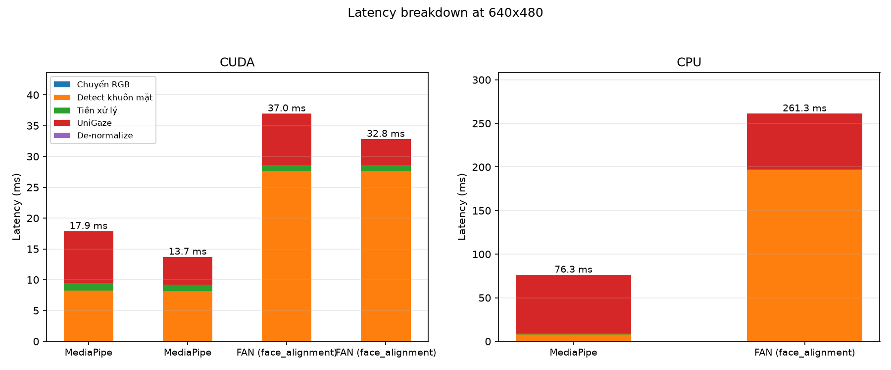

# Báo cáo benchmark kiến trúc pipeline eye tracking

> **Nguồn:** báo cáo này được chuyển từ repo nghiên cứu `EyetrackingResearch`
> (commit `f8bf481`) sang `docs/`. Pipeline torch gốc và các công cụ thu/chấm
> (`tools/collect.py`, `tools/evaluate.py`, `benchmark/*.py`) **không** còn trong
> repo này; lệnh `python tools/...` bên dưới chỉ chạy trong repo nghiên cứu đó.
> Dữ liệu ảnh mặt và kết quả thô nằm ở `benchmarks/gaze/testdata/` (gitignored)
> và `benchmarks/gaze/research-results/`.

- Thời điểm đo: `2026-11-24T19:48:54`
- Mã lần chạy: `20261124_194619`
- Ảnh đầu vào: `benchmarks/gaze/testdata/20261124_175802_frontal/frames/0001/00.jpg` (resize về từng độ phân giải bên dưới)
- Số vòng đo: 100 vòng/cấu hình trên CUDA, 15 vòng/cấu hình trên CPU

## Tóm tắt

- Cấu hình nhanh nhất ở 640x480: **MediaPipe / CUDA / fp16** – **71.4 FPS** (14.0 ms/frame).
- Trên GPU, MediaPipe đạt 58 FPS còn FAN đạt 27 FPS (chậm hơn 2.2 lần).
- Trên CPU, MediaPipe đạt 12.8 FPS, FAN đạt 3.7 FPS – MediaPipe và FAN không đạt ngưỡng 30 FPS của webcam.
- VRAM ổn định tối đa 630 MB; riêng lần suy luận đầu, FAN có thể tạo đỉnh VRAM tạm thời rất lớn (xem mục Nhận xét).

## 1. Môi trường đo

| Thành phần | Giá trị |
| --- | --- |
| OS | Linux 7.0.0-43-generic (hieuserver) |
| CPU | x86_64 / 12 luồng |
| RAM | 30.7 GB |
| GPU | NVIDIA GeForce RTX 3060 / 11.6 GB |
| Python | 3.13.18 |
| PyTorch | 2.15.0+cu132 |
| CUDA / cuDNN | 13.2 / 92600 |
| OpenCV | 5.1.0 |
| MediaPipe | 1.2.3 |
| face_alignment | 1.5.0 |
| UniGaze | 0.1.3 |

## 2. Cách chạy lại

```bash
# Chạy toàn bộ cấu hình (mediapipe/face_alignment x cuda/cpu), ghi JSON + báo cáo
python benchmark/benchmark.py

# Chỉ đo một số cấu hình / độ phân giải
python benchmark/benchmark.py --detectors mediapipe --devices cuda --resolutions 640x480

# So sánh fp16 vs fp32 cho UniGaze (fp16 chỉ chạy trên cuda)
python benchmark/benchmark.py --devices cuda --precisions fp32,fp16
```

Kết quả thô (JSON từng cấu hình + `aggregate.json`) nằm trong `benchmarks/gaze/research-results/results/20261124_194619/`, bản mới nhất ở `benchmarks/gaze/research-results/results/latest.json`.

## 3. Kết quả tổng hợp

### Độ phân giải 640x480

| Bộ phát hiện | Thiết bị | FPS | Mean (ms) | p50 (ms) | p95 (ms) | Khởi tạo (s) | VRAM ổn định (MB) | VRAM đỉnh (MB) | RAM (MB) |
| --- | --- | --- | --- | --- | --- | --- | --- | --- | --- |
| MediaPipe | CUDA | 57.6 | 17.4 | 17.4 | 18.0 | 0.63 | 345 | 345 | 1387 |
| MediaPipe | CPU | 12.8 | 78.1 | 73.3 | 100.6 | 0.59 | - | - | 1324 |
| MediaPipe | CUDA | 71.4 | 14.0 | 13.9 | 14.6 | 0.65 | 189 | 189 | 1620 |
| FAN (face_alignment) | CUDA | 26.6 | 37.6 | 37.0 | 37.6 | 0.91 | 552 | 8997 | 1909 |
| FAN (face_alignment) | CPU | 3.7 | 267.3 | 258.6 | 303.8 | 0.79 | - | - | 1556 |
| FAN (face_alignment) | CUDA | 30.1 | 33.2 | 32.7 | 33.3 | 0.89 | 396 | 8841 | 2203 |

### Độ phân giải 1280x720

| Bộ phát hiện | Thiết bị | FPS | Mean (ms) | p50 (ms) | p95 (ms) | Khởi tạo (s) | VRAM ổn định (MB) | VRAM đỉnh (MB) | RAM (MB) |
| --- | --- | --- | --- | --- | --- | --- | --- | --- | --- |
| MediaPipe | CUDA | 54.1 | 18.5 | 18.0 | 19.1 | 0.61 | 345 | 345 | 1395 |
| MediaPipe | CPU | 12.8 | 78.3 | 74.2 | 96.5 | 0.58 | - | - | 1339 |
| MediaPipe | CUDA | 67.8 | 14.7 | 14.4 | 15.3 | 0.62 | 189 | 189 | 1628 |
| FAN (face_alignment) | CUDA | 20.5 | 48.8 | 48.5 | 48.9 | 0.89 | 630 | 9261 | 1922 |
| FAN (face_alignment) | CPU | 2.2 | 452.6 | 445.3 | 475.3 | 0.78 | - | - | 1603 |
| FAN (face_alignment) | CUDA | 22.3 | 44.8 | 44.4 | 44.9 | 0.89 | 474 | 9104 | 2173 |

### So sánh precision fp16 vs fp32

| Bộ phát hiện | Độ phân giải | Precision | FPS | Mean (ms) | p95 (ms) | UniGaze (ms) | Detect (ms) | VRAM (MB) |
| --- | --- | --- | --- | --- | --- | --- | --- | --- |
| MediaPipe | 640x480 | fp32 | 57.6 | 17.4 | 18.0 | 8.4 | 8.2 | 345 |
| MediaPipe | 640x480 | fp16 | 71.4 | 14.0 | 14.6 | 4.4 | 8.1 | 189 |
| FAN (face_alignment) | 640x480 | fp32 | 26.6 | 37.6 | 37.6 | 8.2 | 27.6 | 552 |
| FAN (face_alignment) | 640x480 | fp16 | 30.1 | 33.2 | 33.3 | 4.1 | 27.6 | 396 |
| MediaPipe | 1280x720 | fp32 | 54.1 | 18.5 | 19.1 | 8.4 | 8.7 | 345 |
| MediaPipe | 1280x720 | fp16 | 67.8 | 14.7 | 15.3 | 4.5 | 8.8 | 189 |
| FAN (face_alignment) | 1280x720 | fp32 | 20.5 | 48.8 | 48.9 | 8.2 | 39.2 | 630 |
| FAN (face_alignment) | 1280x720 | fp16 | 22.3 | 44.8 | 44.9 | 4.1 | 39.1 | 474 |

- Chỉ **UniGaze** chạy theo precision này; bước detect (MediaPipe TFLite / FAN) giữ nguyên nên chênh lệch FPS nằm ở cột **UniGaze**.
- fp16 chỉ hợp lệ trên CUDA; cấu hình CPU luôn fp32.

### Tải hệ thống lúc đo

| Độ phân giải | Bộ phát hiện | Thiết bị | Tải GPU (%) | Xung GPU (MHz) | CPU (%) |
| --- | --- | --- | --- | --- | --- |
| 640x480 | MediaPipe | CUDA | 47 | 1957 / 2130 | 1 |
| 640x480 | MediaPipe | CPU | 0 | 375 / 2130 | 8 |
| 640x480 | MediaPipe | CUDA | 32 | 1807 / 2130 | 3 |
| 640x480 | FAN (face_alignment) | CUDA | 89 | 1942 / 2130 | 2 |
| 640x480 | FAN (face_alignment) | CPU | 0 | 210 / 2130 | 3 |
| 640x480 | FAN (face_alignment) | CUDA | 88 | 1950 / 2130 | 1 |
| 1280x720 | MediaPipe | CUDA | 45 | 1965 / 2130 | 1 |
| 1280x720 | MediaPipe | CPU | 0 | 397 / 2130 | 2 |
| 1280x720 | MediaPipe | CUDA | 28 | 1807 / 2130 | 1 |
| 1280x720 | FAN (face_alignment) | CUDA | 85 | 1965 / 2130 | 1 |
| 1280x720 | FAN (face_alignment) | CPU | 0 | 210 / 2130 | 4 |
| 1280x720 | FAN (face_alignment) | CUDA | 90 | 1965 / 2130 | 2 |

> Số đo trên frame tĩnh, chỉ tính phần xử lý của pipeline (không gồm đọc camera, vẽ giao diện và calibration). Số đo có thể bị ảnh hưởng nếu lúc chạy còn ứng dụng khác dùng GPU/CPU; xung GPU càng gần mức tối đa thì số đo càng đáng tin.

## 4. Phân rã thời gian từng tầng

Số liệu là trung bình ms và tỉ lệ % so với tổng thời gian các tầng.

### Độ phân giải 640x480

| Bộ phát hiện | Thiết bị | Chuyển RGB | Detect khuôn mặt | Tiền xử lý | UniGaze | De-normalize | Tổng (ms) |
| --- | --- | --- | --- | --- | --- | --- | --- |
| MediaPipe | CUDA | 0.1 (0%) | 8.2 (46%) | 1.2 (7%) | 8.4 (47%) | 0.1 (0%) | 17.9 |
| MediaPipe | CPU | 0.1 (0%) | 7.9 (10%) | 1.0 (1%) | 67.3 (88%) | 0.1 (0%) | 76.3 |
| MediaPipe | CUDA | 0.0 (0%) | 8.1 (59%) | 1.1 (8%) | 4.4 (32%) | 0.1 (0%) | 13.7 |
| FAN (face_alignment) | CUDA | 0.1 (0%) | 27.6 (75%) | 1.1 (3%) | 8.2 (22%) | 0.1 (0%) | 37.0 |
| FAN (face_alignment) | CPU | 0.1 (0%) | 196.9 (75%) | 0.9 (0%) | 63.3 (24%) | 0.1 (0%) | 261.3 |
| FAN (face_alignment) | CUDA | 0.1 (0%) | 27.6 (84%) | 1.0 (3%) | 4.1 (12%) | 0.1 (0%) | 32.8 |

### Độ phân giải 1280x720

| Bộ phát hiện | Thiết bị | Chuyển RGB | Detect khuôn mặt | Tiền xử lý | UniGaze | De-normalize | Tổng (ms) |
| --- | --- | --- | --- | --- | --- | --- | --- |
| MediaPipe | CUDA | 0.1 (1%) | 8.7 (47%) | 1.3 (7%) | 8.4 (45%) | 0.1 (0%) | 18.6 |
| MediaPipe | CPU | 0.2 (0%) | 10.2 (13%) | 1.1 (1%) | 65.7 (85%) | 0.1 (0%) | 77.2 |
| MediaPipe | CUDA | 0.1 (1%) | 8.8 (60%) | 1.2 (8%) | 4.5 (31%) | 0.1 (0%) | 14.7 |
| FAN (face_alignment) | CUDA | 0.1 (0%) | 39.2 (81%) | 1.1 (2%) | 8.2 (17%) | 0.1 (0%) | 48.6 |
| FAN (face_alignment) | CPU | 0.2 (0%) | 394.4 (86%) | 0.9 (0%) | 65.1 (14%) | 0.1 (0%) | 460.7 |
| FAN (face_alignment) | CUDA | 0.1 (0%) | 39.1 (88%) | 1.1 (2%) | 4.1 (9%) | 0.1 (0%) | 44.5 |

## 5. Biểu đồ





## 6. Nhận xét

- Ở 640x480 (độ phân giải webcam thường dùng), cấu hình nhanh nhất là **MediaPipe / CUDA / fp16** với **71.4 FPS** (trung bình 14.0 ms/frame).
- Tại 640x480, chạy GPU so với CPU: MediaPipe nhanh hơn **4.5 lần** và FAN (face_alignment) nhanh hơn **7.1 lần**.
- Cùng thiết bị tại 640x480: trên CUDA MediaPipe nhanh hơn FAN **2.2 lần** và trên CPU MediaPipe nhanh hơn FAN **3.4 lần**.
- Ở 640x480 / CUDA, MediaPipe: **UniGaze** chiếm ~47% thời gian (8.4 ms/frame).
- Ở 640x480 / CUDA, FAN (face_alignment): **Detect khuôn mặt** chiếm ~75% thời gian (27.6 ms/frame).
- Ở 640x480 / CPU, MediaPipe: **UniGaze** chiếm ~88% thời gian (67.3 ms/frame).
- Ở 640x480 / CPU, FAN (face_alignment): **Detect khuôn mặt** chiếm ~75% thời gian (196.9 ms/frame).
- Tăng độ phân giải từ 640x480 lên 1280x720 (CUDA): MediaPipe chậm thêm **6%** và FAN (face_alignment) chậm thêm **30%**.
- VRAM ổn định cao nhất là **630 MB** (FAN (face_alignment) / CUDA / fp32, 1280x720), tức ~5% của 11.6 GB VRAM.
- Lưu ý: lần suy luận đầu tiên của FAN (face_alignment) tạo đỉnh VRAM tạm thời **9261 MB** (do `torch.backends.cudnn.benchmark` được bật trong `face_alignment` để autotune), sau đó giảm còn khoảng 630 MB. GPU dưới ~10 GB có thể bị OOM ở lần chạy đầu.
- Thời gian khởi tạo model khoảng 0.58–0.91 s tùy cấu hình (đã tính load weight lên thiết bị).
- Lúc đo, xung GPU thấp nhất chỉ đạt ~85% mức tối đa (MediaPipe / CUDA / fp16, tải GPU 32%), nên FPS thực tế có thể cao hơn số trong bảng. Nên tắt bớt ứng dụng nền rồi chạy lại benchmark để có số liệu sạch.
- Khuyến nghị: khi cần độ trễ thấp cho thời gian thực, dùng **MediaPipe FaceMesh + CUDA**. Cả hai backend đều dùng đúng 6 điểm chuẩn hóa của UniGaze (4 góc mắt + 2 cánh mũi), nên chỉ nên chọn FAN khi thực sự cần 68 điểm mốc iBUG đầy đủ.
- Nếu không có GPU, nên dùng MediaPipe: FAN chạy CPU rất chậm và không đạt ngưỡng thời gian thực cho webcam.

## 7. Ghi chú phương pháp

- Mỗi cấu hình chạy trong một process riêng để số đo VRAM không bị cộng dồn giữa các cấu hình.
- Có làm nóng (warmup) trước khi đo để loại bỏ chi phí khởi tạo CUDA context và cache.
- VRAM lấy từ `torch.cuda.max_memory_allocated/reserved`, gồm cả lúc load model nhưng **không gồm** CUDA context của driver (thường vài trăm MB).
- Cột **VRAM ổn định** là đỉnh bộ nhớ trong lúc đo (sau warmup); cột **VRAM đỉnh** tính cả lần suy luận đầu tiên (có thể phát sinh autotune của cuDNN).
- MediaPipe luôn chạy trên CPU (delegate CPU), nên cột thiết bị chỉ ảnh hưởng tới UniGaze và bước chuẩn hóa ảnh; FAN chạy trên thiết bị được chọn.
- Cả hai backend dùng đúng 6 điểm chuẩn hóa của UniGaze (4 góc mắt + 2 cánh mũi): MediaPipe FaceMesh lấy index `[33, 133, 362, 263, 75, 290]`, FAN lấy iBUG `[36, 39, 42, 45, 31, 35]`, nên bước chuẩn hóa ảnh giống nhau về hình học.
- Đo trên ảnh tĩnh nên thời gian detect không phụ thuộc chuyển động; khi chạy webcam thật, FPS còn bị giới hạn bởi tốc độ camera và phần hiển thị.
- Bảng **Tải hệ thống lúc đo** là snapshot GPU/CPU ở cuối mỗi cấu hình; số đo sẽ nhiễu nếu lúc chạy còn ứng dụng nền dùng GPU/CPU.
