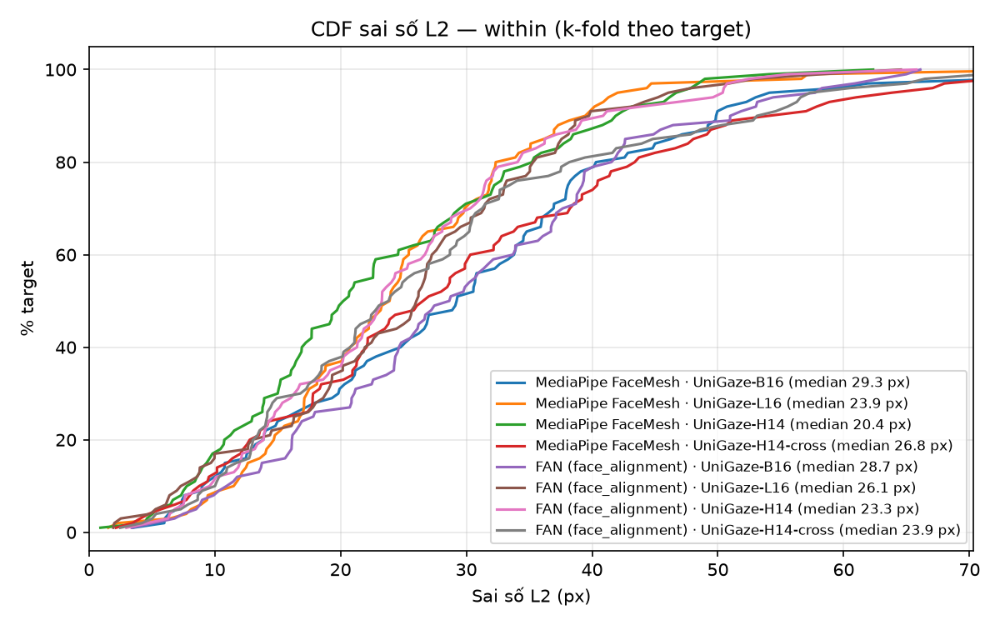
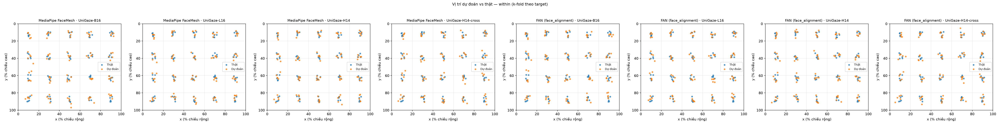

# Báo cáo độ chính xác pipeline eye tracking

> **Nguồn:** báo cáo này được chuyển từ repo nghiên cứu `EyetrackingResearch`
> (commit `f8bf481`) sang `docs/`. Pipeline torch gốc và các công cụ thu/chấm
> (`tools/collect.py`, `tools/evaluate.py`, `benchmark/*.py`) **không** còn trong
> repo này; lệnh `python tools/...` bên dưới chỉ chạy trong repo nghiên cứu đó.
> Dữ liệu ảnh mặt và kết quả thô nằm ở `benchmarks/gaze/testdata/` (gitignored)
> và `benchmarks/gaze/research-results/`.

- Thời điểm chấm: `2026-11-24T20:25:54+07:00`
- Thiết bị: `cuda`
- Độ chính xác số: `fp32`
- Model UniGaze: `unigaze_b16_joint.safetensors, unigaze_l16_joint.safetensors, unigaze_h14_joint.safetensors, unigaze_h14_cross_X.safetensors`
- Dữ liệu: `benchmarks/gaze/testdata` (thu bằng `tools/collect.py` của repo nghiên cứu)

## Tóm tắt

- Dữ liệu: **100 target** / 800 frame từ **1 phiên**, tư thế: frontal.
- Giao thức chính: **within (k-fold theo target)**.
- MediaPipe FaceMesh · UniGaze-B16: L2 trung vị **29.3 px** (CI 95% 25.0–33.8 px), L1 38.6 px, ≈0.59° (quy đổi), jitter 0.77°.
- MediaPipe FaceMesh · UniGaze-L16: L2 trung vị **23.9 px** (CI 95% 21.0–25.2 px), L1 30.3 px, ≈0.49° (quy đổi), jitter 0.66°.
- MediaPipe FaceMesh · UniGaze-H14: L2 trung vị **20.4 px** (CI 95% 17.2–24.2 px), L1 25.9 px, ≈0.41° (quy đổi), jitter 0.67°.
- MediaPipe FaceMesh · UniGaze-H14-cross: L2 trung vị **26.8 px** (CI 95% 22.2–31.1 px), L1 32.8 px, ≈0.45° (quy đổi), jitter 0.64°.
- FAN (face_alignment) · UniGaze-B16: L2 trung vị **28.7 px** (CI 95% 24.7–33.0 px), L1 36.5 px, ≈0.59° (quy đổi), jitter 0.84°.
- FAN (face_alignment) · UniGaze-L16: L2 trung vị **26.1 px** (CI 95% 22.5–27.4 px), L1 33.8 px, ≈0.54° (quy đổi), jitter 0.70°.
- FAN (face_alignment) · UniGaze-H14: L2 trung vị **23.3 px** (CI 95% 21.4–26.6 px), L1 28.6 px, ≈0.47° (quy đổi), jitter 0.74°.
- FAN (face_alignment) · UniGaze-H14-cross: L2 trung vị **23.9 px** (CI 95% 20.9–28.7 px), L1 30.5 px, ≈0.41° (quy đổi), jitter 0.73°.
- Paired MediaPipe FaceMesh · UniGaze-B16 vs MediaPipe FaceMesh · UniGaze-L16: ΔL2 trung vị **2.82 px** (CI 0.81–6.14) → **MediaPipe FaceMesh · UniGaze-L16 chính xác hơn**.
- Paired MediaPipe FaceMesh · UniGaze-B16 vs MediaPipe FaceMesh · UniGaze-H14: ΔL2 trung vị **6.46 px** (CI 1.73–10.02) → **MediaPipe FaceMesh · UniGaze-H14 chính xác hơn**.
- Paired MediaPipe FaceMesh · UniGaze-B16 vs MediaPipe FaceMesh · UniGaze-H14-cross: ΔL2 trung vị **0.37 px** (CI -3.28–6.27) → **tương đương (|ΔL2| < 2 px)**.
- Paired MediaPipe FaceMesh · UniGaze-B16 vs FAN (face_alignment) · UniGaze-B16: ΔL2 trung vị **-1.08 px** (CI -4.11–3.98) → **tương đương (|ΔL2| < 2 px)**.
- Paired MediaPipe FaceMesh · UniGaze-L16 vs MediaPipe FaceMesh · UniGaze-H14: ΔL2 trung vị **2.35 px** (CI -1.02–5.25) → **tương đương (CI chứa 0)**.
- Paired MediaPipe FaceMesh · UniGaze-L16 vs MediaPipe FaceMesh · UniGaze-H14-cross: ΔL2 trung vị **-2.34 px** (CI -5.38–1.92) → **tương đương (CI chứa 0)**.
- Paired MediaPipe FaceMesh · UniGaze-L16 vs FAN (face_alignment) · UniGaze-L16: ΔL2 trung vị **-1.54 px** (CI -5.31–0.83) → **tương đương (|ΔL2| < 2 px)**.
- Paired MediaPipe FaceMesh · UniGaze-H14 vs MediaPipe FaceMesh · UniGaze-H14-cross: ΔL2 trung vị **-5.63 px** (CI -11.64–0.28) → **tương đương (CI chứa 0)**.
- Paired MediaPipe FaceMesh · UniGaze-H14 vs FAN (face_alignment) · UniGaze-H14: ΔL2 trung vị **-2.69 px** (CI -5.05–0.39) → **tương đương (CI chứa 0)**.
- Paired MediaPipe FaceMesh · UniGaze-H14-cross vs FAN (face_alignment) · UniGaze-H14-cross: ΔL2 trung vị **2.99 px** (CI 0.35–6.72) → **FAN (face_alignment) · UniGaze-H14-cross chính xác hơn**.
- Paired FAN (face_alignment) · UniGaze-B16 vs FAN (face_alignment) · UniGaze-L16: ΔL2 trung vị **3.21 px** (CI 0.39–8.17) → **FAN (face_alignment) · UniGaze-L16 chính xác hơn**.
- Paired FAN (face_alignment) · UniGaze-B16 vs FAN (face_alignment) · UniGaze-H14: ΔL2 trung vị **5.57 px** (CI 1.46–9.96) → **FAN (face_alignment) · UniGaze-H14 chính xác hơn**.
- Paired FAN (face_alignment) · UniGaze-B16 vs FAN (face_alignment) · UniGaze-H14-cross: ΔL2 trung vị **1.30 px** (CI -2.57–6.27) → **tương đương (|ΔL2| < 2 px)**.
- Paired FAN (face_alignment) · UniGaze-L16 vs FAN (face_alignment) · UniGaze-H14: ΔL2 trung vị **-0.01 px** (CI -3.91–3.51) → **tương đương (|ΔL2| < 2 px)**.
- Paired FAN (face_alignment) · UniGaze-L16 vs FAN (face_alignment) · UniGaze-H14-cross: ΔL2 trung vị **-0.53 px** (CI -3.93–3.91) → **tương đương (|ΔL2| < 2 px)**.
- Paired FAN (face_alignment) · UniGaze-H14 vs FAN (face_alignment) · UniGaze-H14-cross: ΔL2 trung vị **-2.03 px** (CI -7.59–1.17) → **tương đương (CI chứa 0)**.
- Nếu 2 detector tương đương trong sai số pixel, chọn theo FPS (xem `benchmark_report.md`).

## 1. Dữ liệu

| Phiên | Tư thế | Tạo lúc | Target | Frame | Màn hình | pipeline_ok | dry-run |
| --- | --- | --- | --- | --- | --- | --- | --- |
| `20261124_175802_frontal` | frontal | 2026-11-24 18:01 | 100 | 800 | 1920x1080 | 100% |  |

- `pipeline_ok` = tỉ lệ target mà pipeline (detector dùng lúc thu) xử lý được ngay khi thu dữ liệu, chỉ để tham khảo.
- `benchmarks/gaze/testdata/` là dữ liệu test độc lập: **không** dùng để fit `weights/calibrator.ubj`.

## 2. Cách chấm điểm

- Mỗi target: lấy median `(pitch, yaw)` trên các frame hợp lệ; `std` của các frame là **jitter** trong một fixation.
- Mapping `(pitch, yaw) -> (x/W, y/H)` fit bằng `LinearRegression` giống `calibration.py`, sau đó nhân lại kích thước màn hình của phiên để ra pixel.
- `within`: k-fold theo target **trong từng phiên** (mapping không thấy mẫu đang chấm).
- `cross-session`: leave-one-session-out — fit trên các phiên khác, chấm phiên bị giữ lại. Đây là số trung thực cho tình huống ngày khác / ánh sáng khác.
- `L2/L1` tính bằng pixel, thêm `% chiều rộng` để so được giữa các màn hình khác kích thước.
- `≈ độ` là quy đổi tham khảo từ Jacobian của mapping (không đo khoảng cách mắt–màn hình), không dùng để so sánh chéo giữa các phiên.
- CI 95% bằng bootstrap: resample **theo phiên** (cluster), nếu chỉ có 1 phiên thì resample theo target nên CI hẹp hơn thực tế.
- Đơn vị độc lập là **target**, không phải frame: các frame trong một fixation tương quan mạnh nên không tính là mẫu độc lập.

## 3. Kết quả

### 3.1. within (k-fold theo target)

| Cấu hình | n target | L2 median [CI 95%] | L2 p95 | L1 median | bias dx | bias dy | ≈ độ | jitter | detect fail | gate 80° | L2 (% rộng) |
| --- | --- | --- | --- | --- | --- | --- | --- | --- | --- | --- | --- |
| MediaPipe FaceMesh · UniGaze-B16 | 100 | 29.3 [25.0–33.8] | 54.4 | 38.6 | 0.0 | -0.3 | 0.59° | 0.77° | 0.0% | 0.0% | 1.5% |
| MediaPipe FaceMesh · UniGaze-L16 | 100 | 23.9 [21.0–25.2] | 42.1 | 30.3 | -0.0 | -0.3 | 0.49° | 0.66° | 0.0% | 0.0% | 1.2% |
| MediaPipe FaceMesh · UniGaze-H14 | 100 | 20.4 [17.2–24.2] | 46.7 | 25.9 | -0.1 | -0.3 | 0.41° | 0.67° | 0.0% | 0.0% | 1.1% |
| MediaPipe FaceMesh · UniGaze-H14-cross | 100 | 26.8 [22.2–31.1] | 64.0 | 32.8 | 0.0 | -0.4 | 0.45° | 0.64° | 0.0% | 0.0% | 1.4% |
| FAN (face_alignment) · UniGaze-B16 | 100 | 28.7 [24.7–33.0] | 57.8 | 36.5 | -0.1 | -0.4 | 0.59° | 0.84° | 0.0% | 0.0% | 1.5% |
| FAN (face_alignment) · UniGaze-L16 | 100 | 26.1 [22.5–27.4] | 46.1 | 33.8 | -0.0 | -0.4 | 0.54° | 0.70° | 0.0% | 0.0% | 1.4% |
| FAN (face_alignment) · UniGaze-H14 | 100 | 23.3 [21.4–26.6] | 50.4 | 28.6 | 0.1 | -0.1 | 0.47° | 0.74° | 0.0% | 0.0% | 1.2% |
| FAN (face_alignment) · UniGaze-H14-cross | 100 | 23.9 [20.9–28.7] | 57.5 | 30.5 | -0.1 | -0.2 | 0.41° | 0.73° | 0.0% | 0.0% | 1.2% |

### 3.2. Cross-session (leave-one-session-out)

Chưa đủ 2 phiên nên chưa chấm được. Thu thêm phiên khác ngày rồi chạy lại.

### 3.3. Theo từng phiên (within (k-fold theo target))

| Cấu hình | Phiên | n target | L2 median | L2 p95 | L1 median |
| --- | --- | --- | --- | --- | --- |
| MediaPipe FaceMesh · UniGaze-B16 | `20261124_175802_frontal` | 100 | 29.3 | 54.4 | 38.6 |
| MediaPipe FaceMesh · UniGaze-L16 | `20261124_175802_frontal` | 100 | 23.9 | 42.1 | 30.3 |
| MediaPipe FaceMesh · UniGaze-H14 | `20261124_175802_frontal` | 100 | 20.4 | 46.7 | 25.9 |
| MediaPipe FaceMesh · UniGaze-H14-cross | `20261124_175802_frontal` | 100 | 26.8 | 64.0 | 32.8 |
| FAN (face_alignment) · UniGaze-B16 | `20261124_175802_frontal` | 100 | 28.7 | 57.8 | 36.5 |
| FAN (face_alignment) · UniGaze-L16 | `20261124_175802_frontal` | 100 | 26.1 | 46.1 | 33.8 |
| FAN (face_alignment) · UniGaze-H14 | `20261124_175802_frontal` | 100 | 23.3 | 50.4 | 28.6 |
| FAN (face_alignment) · UniGaze-H14-cross | `20261124_175802_frontal` | 100 | 23.9 | 57.5 | 30.5 |

### 3.4. So sánh paired (within (k-fold theo target))

| Cặp so sánh | n target | ΔL2 median [CI 95%] | ΔL1 median | Δbias dx | Δbias dy | Kết luận |
| --- | --- | --- | --- | --- | --- | --- |
| MediaPipe FaceMesh · UniGaze-B16 vs MediaPipe FaceMesh · UniGaze-L16 | 100 | 2.82 [0.81–6.14] | 4.43 | 0.1 | -0.0 | MediaPipe FaceMesh · UniGaze-L16 chính xác hơn |
| MediaPipe FaceMesh · UniGaze-B16 vs MediaPipe FaceMesh · UniGaze-H14 | 100 | 6.46 [1.73–10.02] | 8.17 | 0.2 | 0.0 | MediaPipe FaceMesh · UniGaze-H14 chính xác hơn |
| MediaPipe FaceMesh · UniGaze-B16 vs MediaPipe FaceMesh · UniGaze-H14-cross | 100 | 0.37 [-3.28–6.27] | 3.16 | 0.0 | 0.1 | tương đương (|ΔL2| < 2 px) |
| MediaPipe FaceMesh · UniGaze-B16 vs FAN (face_alignment) · UniGaze-B16 | 100 | -1.08 [-4.11–3.98] | 0.24 | 0.1 | 0.1 | tương đương (|ΔL2| < 2 px) |
| MediaPipe FaceMesh · UniGaze-L16 vs MediaPipe FaceMesh · UniGaze-H14 | 100 | 2.35 [-1.02–5.25] | 2.82 | 0.1 | 0.0 | tương đương (CI chứa 0) |
| MediaPipe FaceMesh · UniGaze-L16 vs MediaPipe FaceMesh · UniGaze-H14-cross | 100 | -2.34 [-5.38–1.92] | -3.50 | -0.1 | 0.1 | tương đương (CI chứa 0) |
| MediaPipe FaceMesh · UniGaze-L16 vs FAN (face_alignment) · UniGaze-L16 | 100 | -1.54 [-5.31–0.83] | -1.68 | -0.0 | 0.1 | tương đương (|ΔL2| < 2 px) |
| MediaPipe FaceMesh · UniGaze-H14 vs MediaPipe FaceMesh · UniGaze-H14-cross | 100 | -5.63 [-11.64–0.28] | -7.18 | -0.2 | 0.1 | tương đương (CI chứa 0) |
| MediaPipe FaceMesh · UniGaze-H14 vs FAN (face_alignment) · UniGaze-H14 | 100 | -2.69 [-5.05–0.39] | -2.85 | -0.2 | -0.2 | tương đương (CI chứa 0) |
| MediaPipe FaceMesh · UniGaze-H14-cross vs FAN (face_alignment) · UniGaze-H14-cross | 100 | 2.99 [0.35–6.72] | 4.91 | 0.1 | -0.2 | FAN (face_alignment) · UniGaze-H14-cross chính xác hơn |
| FAN (face_alignment) · UniGaze-B16 vs FAN (face_alignment) · UniGaze-L16 | 100 | 3.21 [0.39–8.17] | 4.69 | -0.0 | -0.0 | FAN (face_alignment) · UniGaze-L16 chính xác hơn |
| FAN (face_alignment) · UniGaze-B16 vs FAN (face_alignment) · UniGaze-H14 | 100 | 5.57 [1.46–9.96] | 6.74 | -0.2 | -0.3 | FAN (face_alignment) · UniGaze-H14 chính xác hơn |
| FAN (face_alignment) · UniGaze-B16 vs FAN (face_alignment) · UniGaze-H14-cross | 100 | 1.30 [-2.57–6.27] | 2.78 | 0.0 | -0.2 | tương đương (|ΔL2| < 2 px) |
| FAN (face_alignment) · UniGaze-L16 vs FAN (face_alignment) · UniGaze-H14 | 100 | -0.01 [-3.91–3.51] | 1.42 | -0.1 | -0.3 | tương đương (|ΔL2| < 2 px) |
| FAN (face_alignment) · UniGaze-L16 vs FAN (face_alignment) · UniGaze-H14-cross | 100 | -0.53 [-3.93–3.91] | -1.35 | 0.1 | -0.2 | tương đương (|ΔL2| < 2 px) |
| FAN (face_alignment) · UniGaze-H14 vs FAN (face_alignment) · UniGaze-H14-cross | 100 | -2.03 [-7.59–1.17] | -2.52 | 0.2 | 0.1 | tương đương (CI chứa 0) |

Δ = cấu hình A trừ cấu hình B trên **cùng target**; ΔL2 âm nghĩa là A lỗi nhỏ hơn. Kết luận dựa trên CI 95% của ΔL2 (bootstrap theo phiên).

## 4. Biểu đồ





## 5. Cảnh báo

- Chỉ có 1 phiên: chưa chấm được `cross-session`, còn `within` lạc quan hơn thực tế (cùng phiên, cùng vị trí đầu).

## 6. Cách chạy lại

```bash
# Thu thêm 1 phiên (mỗi lần chạy là 1 phiên mới, chạy bao nhiêu lần cũng được)
python tools/collect.py --targets 100

# Chấm điểm toàn bộ dữ liệu đã thu
python tools/evaluate.py

# So sánh fp16 vs fp32 cho UniGaze (chỉ trên cuda)
python tools/evaluate.py --precisions fp32,fp16

# So sánh các kích thước UniGaze
python tools/evaluate.py --gaze-weights weights/unigaze_b16_joint.safetensors,weights/unigaze_l16_joint.safetensors,weights/unigaze_h14_joint.safetensors,weights/unigaze_h14_cross_X.safetensors

# Xoá cache kết quả pipeline (ví dụ sau khi đổi model/crop_scale)
python tools/evaluate.py --clear-cache
```

- Cache nằm ở `benchmarks/gaze/testdata/.cache/` và tự xoá khi code pipeline thay đổi (`models.py`, `preprocessing.py`, `utils.py`, `tools/evaluate.py`).
- Mỗi target lưu tối đa 8 frame JPEG trong 400 ms cuối của dwell.

